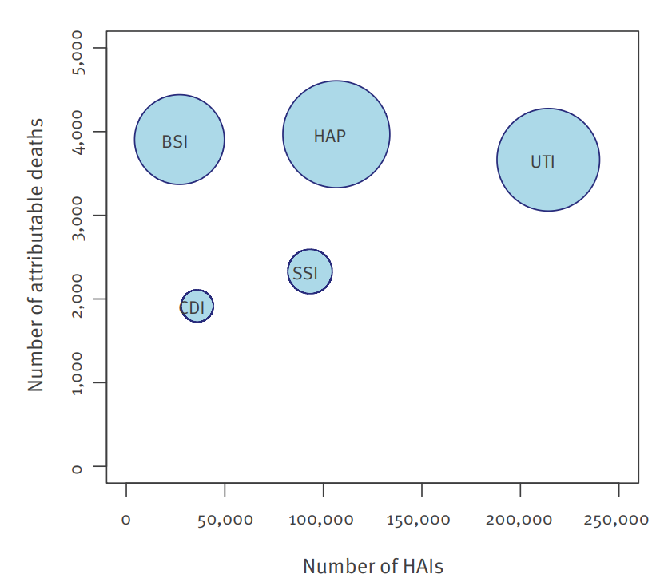

## Problem description

Hospitals are places where people go to recover, but healthcare itself can sometimes expose patients to additional infections. These **healthcare-associated infections (HAIs)** can lead to longer illnesses, disability and premature death, creating an additional burden for patients and healthcare systems.

For hospital administrators, knowing how many infections occur is important, but it is only part of the picture. An infection that occurs frequently may not necessarily cause the greatest overall health loss. Conversely, a less common infection can have serious consequences for the patients affected.

A study by Zacher et al. (2019) examined five types of healthcare-associated infections in Germany and compared their estimated burden with the European Union/European Economic Area (EU/EEA). This raises two important questions: **Do the most common infections account for the greatest health burden? And how does the estimated burden in Germany compare with the EU/EEA average when measured across the population?**

This analysis explores those questions using estimates of infection cases, attributable deaths and disability-adjusted life years (DALYs) from the study.

## Analysis

The estimates in this analysis come from a study by Zacher et al. (2019), which used data from the European Centre for Disease Prevention and Control (ECDC) point prevalence survey of healthcare-associated infections in acute-care hospitals during 2011–2012. The researchers estimated the burden of five infection types in Germany and compared the results with the EU/EEA average.

### The scale of the problem

For Germany, the study estimated that the five infections examined accounted for **478,222 cases, 16,245 attributable deaths and 248,920 disability-adjusted life years (DALYs) in 2011**.

DALYs measure health loss by combining years of life lost due to premature death with years lived with disability. This helps compare infections that differ in both frequency and severity.

The headline figures show the scale of the problem, but they do not tell the whole story. To understand where the burden falls, we need to look at how the results differ across infection types.

### When more cases do not mean more health loss

Urinary tract infections (UTIs) were the most common of the five infections studied in Germany. However, healthcare-associated pneumonia (HAP) produced a greater estimated health burden despite having roughly half as many cases. Bloodstream infections (BSI) also contributed substantially to health loss despite being less common.

@tbl-hai-burden compares the estimated cases and disability-adjusted life years (DALYs) for these three infections in Germany in 2011.

| Infection type | Estimated cases | Estimated DALYs |
|:--|--:|--:|
| Urinary tract infection (UTI) | 214,150 | 66,701 |
| Healthcare-associated pneumonia (HAP) | 106,586 | 69,508 |
| Bloodstream infection (BSI) | 26,976 | 58,350 |

: Estimated cases and DALYs for three healthcare-associated infections in Germany, 2011. Source: Zacher et al. (2019), Table 1. {#tbl-hai-burden}

The contrast is clear. UTIs accounted for the most cases, but HAP had the highest estimated DALY total among these three infections. BSI had far fewer cases than either UTI or HAP, yet its estimated health burden was still substantial. For hospital decision-makers, this shows why infection frequency alone may not adequately describe the impact on population health.

### Germany and the EU/EEA: two different perspectives

The comparison becomes more interesting when infection rates are considered alongside the size of the population affected. Zacher et al. (2019) estimated that Germany had **2.40 infections per 100 hospitalised patients**, compared with **2.83 per 100** across the EU/EEA. Viewed this way, Germany's incidence was lower.

However, the picture changes when the estimates are expressed per 100,000 people in the population. Germany had an estimated **592.1 infections per 100,000 people**, compared with **467.9** across the EU/EEA. The estimated burden of attributable deaths and DALYs per 100,000 people was also higher in Germany.

@tbl-country-comparison summarises these differences.

| Measure | Germany | EU/EEA |
|:--|--:|--:|
| Infections per 100 hospitalised patients | 2.40 | 2.83 |
| Infections per 100,000 population | 592.1 | 467.9 |
| Attributable deaths per 100,000 population | 20.1 | 15.3 |
| DALYs per 100,000 population | 308.2 | 290.0 |

: Estimated healthcare-associated infection incidence and population-level burden in Germany and the EU/EEA, 2011–2012. Source: Zacher et al. (2019), Table 2. {#tbl-country-comparison}

These measures use different denominators, so they answer different questions. The first describes incidence among hospitalised patients; the population-level measures describe the estimated burden relative to the entire population. They should not be interpreted as interchangeable rates.

The authors suggest that Germany's larger number of hospital beds and hospitalised patients may help explain its higher population-level burden, despite its lower incidence among hospitalised patients. This is a proposed explanation, rather than proof that hospital capacity alone caused the difference.

### Where does the burden fall?

The overall comparison shows the scale of the problem, but not how infection frequency relates to deaths and health loss. The figure below explores this relationship across five types of healthcare-associated infections in Germany.

{#fig-hai-burden width=80%}

As shown in @fig-hai-burden, UTIs account for the greatest number of infections, but HAP has a higher estimated DALY total despite having roughly half as many cases. BSI also contributes substantially to health loss despite having far fewer cases. This reinforces why infection counts alone do not capture the full impact on health.

## Conclusion

This analysis shows why the burden of healthcare-associated infections cannot be understood through infection counts alone. In Germany, urinary tract infections were the most common of the five infection types, while pneumonia and bloodstream infections contributed substantially to deaths and DALYs despite having fewer cases. The country-level comparison also showed higher estimated infections, attributable deaths and DALYs per 100,000 people in Germany than in the EU/EEA.

These findings matter for healthcare decision-makers because prevention priorities should consider not only how often infections occur, but also the health loss associated with them. However, the estimates come from a specific study period and depend on the data and methods used, so they should not be treated as a description of current infection rates.

Overall, the study by Zacher et al. (2019) demonstrates the value of combining infection counts with measures of mortality and disability when assessing the public-health burden of healthcare-associated infections.

## References

Zacher, B., Haller, S., Willrich, N., Walter, J., Abu Sin, M., Cassini, A., Plachouras, D., Suetens, C., Behnke, M., Gastmeier, P., Wieler, L. H., & Eckmanns, T. (2019). Application of a new methodology and R package reveals a high burden of healthcare-associated infections (HAI) in Germany compared to the average in the European Union/European Economic Area, 2011 to 2012. *Eurosurveillance, 24*(46), 1900135. https://doi.org/10.2807/1560-7917.ES.2019.24.46.1900135

